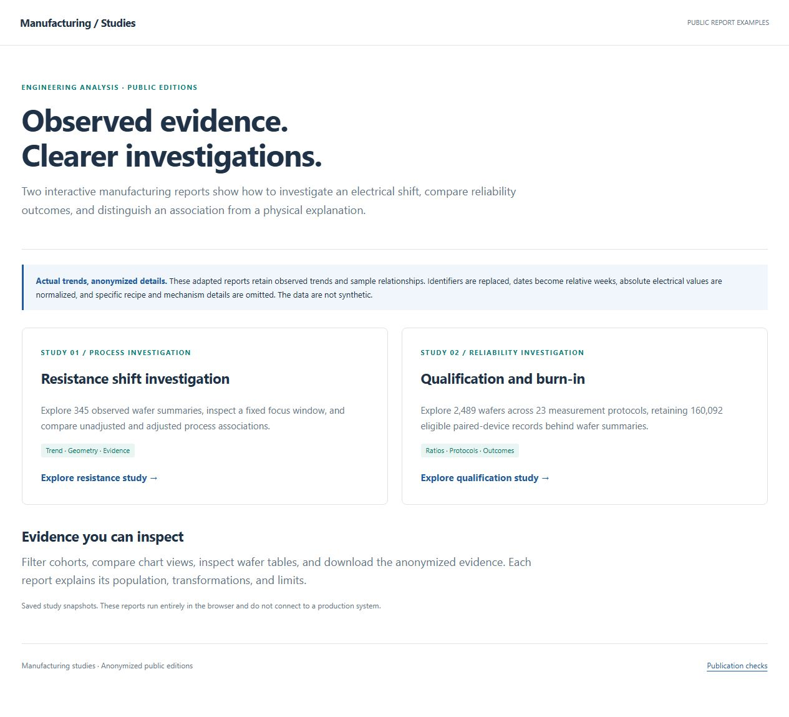
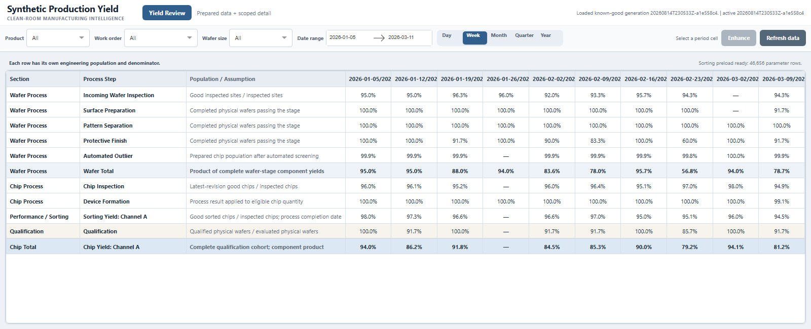

# Matthew Chung

## Quality Engineering, Manufacturing Analytics & Digital Operations

I am a semiconductor quality and manufacturing engineer who builds production software to turn fragmented manufacturing data into engineering decisions and practical tools for daily operations.

My work centers on two flagship systems: a **Manufacturing Yield Platform** that connects process, wafer, and chip yield with the manufacturing events, inspection, and test history behind each result, and a **Manufacturing Application Platform** that delivers custom engineering applications to engineers, technicians, and operations teams.

The investigations below show the engineering questions this work helps answer. The flagships explain the data preparation and shared delivery behind it.

## At a glance

- **Manufacturing data at scale:** **430,000+ prepared process-yield records across 17,000+ wafers**, backed by **tens of millions of inspection and test records** in the October 2026 snapshot.
- **Shared use:** more than **3,000 recorded app/page opens in a measured 30-day period**, across two hosts in September–October 2026. Opens include reloads, not unique users.
- **End-to-end ownership:** manufacturing problem definition, Python/SQL development, analytical validation, deployment, and ongoing support.

[Data scale and scope](case-studies/YIELD.md#data-scale) · [Usage measurement](case-studies/MANUFACTURING_APPLICATION_PLATFORM.md#measured-use)

## Start with the engineering investigations

**What changed? Which population is affected? What evidence should guide the next engineering action?**

Explore an electrical resistance investigation and a qualification/burn-in study, with interactive charts, cohort filters, findings, and supporting methods. These are examples of the analytical work enabled by reusable data preparation and investigation tools; each study explains its own sources and methods.

<a href="https://4sy8zwp9hz-netizen.github.io/webpage_presentation_example/"></a>

**[Open the investigations](https://4sy8zwp9hz-netizen.github.io/webpage_presentation_example/)**

*These linked reports use anonymized observed data, as described on the study site. The software demos in this portfolio use synthetic data.*

<details>
<summary>Try an investigation workflow with fictional data</summary>

**[Open the interactive qualification demo](https://qualification-studio.orange-rat-4119.chatgpt.site)** · [Source code](demos/qualification-studio) · [Case study](case-studies/QUALIFICATION_RELIABILITY_INVESTIGATION.md)

Change products and periods, compare run mates, inspect individual device measurements, and export the selected data. Meeting minutes connect review decisions to evidence and follow-up.

[](https://qualification-studio.orange-rat-4119.chatgpt.site)

*Runnable public demo with fictional records and screen limits.*

</details>

## Two flagship systems behind the work

### 1. Manufacturing Yield Platform — the analytical foundation

Engineers need to understand where yield changes across manufacturing stages, then trace the result through work orders, wafers, chips, and their process, inspection, and test history. The system brings yield events, pass/fail quantities, and stage-specific populations together with high-volume measurement evidence. Repeatedly retrieving and rebuilding that history on each interaction is impractical.

I built the dashboard and evolved its backend through scoped SQL retrieval, Python/pandas transformations, shared caches and preloads, and scheduled Parquet ETL. Common views use prepared facts; selected investigations retrieve high-volume detail on demand. Correction-aware refresh and last-known-good publication protect the answer as records change or refreshes fail.

The data work also supports Chip Yield, wafer comparisons, and linked maps. The interface stayed familiar while extraction, memory use, refresh, and recovery became substantial engineering responsibilities.



*Public synthetic application screenshot. The production-scale counts above describe the internal system, not the size of this demo.*

**[Read the yield case study](case-studies/YIELD.md)** · [Run the synthetic application](https://github.com/4sy8zwp9hz-netizen/manufacturing-analytics-platform) · [Explore wafer comparisons and maps](case-studies/WAFER_QUALITY_INVESTIGATION.md)

### 2. Manufacturing Application Platform — shared tools in daily use

A useful engineering application needs a reliable way to reach the people who use it. I built a common browser portal and hosting model for custom analytics and operational workflows: yield investigation, process monitoring, WIP visibility, shift handoff, maintenance, and request fulfillment.

The platform evolved from local tools and versioned desktop releases to centrally hosted applications, with shared navigation, Waitress/WSGI integration, health checks, logs, restart tooling, and recovery. Selected workloads separate data preparation and serving across two hosts.

Usage records show **3,081 app/page opens over one measured 30-day period**. This is evidence of use across the hosted environment; the case study explains the measurement and its limits.

**[Read the platform case study](case-studies/MANUFACTURING_APPLICATION_PLATFORM.md)** · [See operational workflows](case-studies/LEAN_DIGITAL_OPERATIONS.md)

## Follow the work further

These examples extend the two flagships into specific engineering decisions and daily workflows.

| Area | Examples |
|---|---|
| Investigation and process decisions | [Wafer comparisons and linked maps](case-studies/WAFER_QUALITY_INVESTIGATION.md), [qualification and reliability](case-studies/QUALIFICATION_RELIABILITY_INVESTIGATION.md), and [grating process analytics](case-studies/GRATING_PROCESS_ANALYTICS.md) |
| Daily manufacturing work | [Maintenance, Process Patrol, Clean Room Requests, and supporting tools](case-studies/SUPPORTING_ENGINEERING_TOOLS.md); [production visibility and shift handoff](case-studies/LEAN_DIGITAL_OPERATIONS.md) |
| Technical direction and ownership | [Engineering leadership across the ecosystem](case-studies/ENGINEERING_LEADERSHIP.md) |

## Engineering range

- **Manufacturing and quality:** yield, Pareto, SPC, wafer/lot traceability, inspection/test analysis, WIP, and digital standard work.
- **Data and applications:** Python, SQL Server-compatible access, pandas, Parquet, Dash/Plotly, responsive workflows, caching, and targeted retrieval.
- **Production software:** incremental ETL, tests, configuration, centralized hosting, background refresh, logging, and recovery.

## What I own

I own problem definition, application architecture and development, analytical logic, workflow design, validation, deployment integration, troubleshooting, and support. I work directly with process, manufacturing-system, database, and IT owners; their source systems, enterprise infrastructure, and process approvals remain their responsibilities.

## Confidentiality

Public software examples use synthetic data, generic terminology, and clean-room implementations. They exclude employer source code, credentials, network details, database object names, production records, and confidential process rules. Only aggregate scale and usage measures are reported here. The separately linked investigations describe their anonymized observed-data basis on the study site.

## Repository map

```text
case-studies/   Detailed engineering case studies
assets/         Public previews and synthetic visuals
demos/          Runnable synthetic investigation example
docs/           Supporting portfolio documentation
tools/          Repository validation utilities
.github/        Continuous validation
```

## Contact

- Email: [matthewvchung@gmail.com](mailto:matthewvchung@gmail.com)
- LinkedIn: [Matthew Chung](https://www.linkedin.com/in/matthew-chung-292a0446/)

## License

Documentation and original diagrams are released under the [MIT License](LICENSE). The linked Yield application has its own license and repository history.
