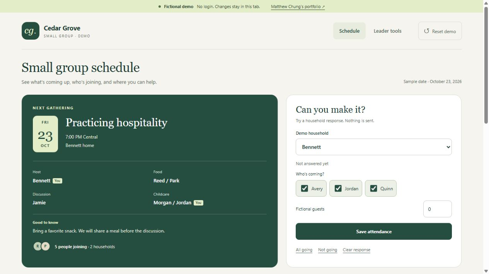

# Matthew Chung

## Quality Engineering, Manufacturing Analytics & Digital Operations

I am a semiconductor quality and manufacturing engineer who uses data to investigate yield losses, evaluate reliability, and guide engineering follow-up. I also build the software that makes this work repeatable and usable by engineers, technicians, and operations teams.

Two flagship systems support this work. The **Manufacturing Yield Platform** connects process, wafer, and chip yield with the manufacturing history behind each result. The **Manufacturing Application Platform** puts custom engineering tools into shared daily use.

Start with the investigations to see how I turn manufacturing questions into evidence. Then explore the two flagships to see how I prepare that evidence and deliver tools that support further investigation and daily operations.

## At a glance

- **Manufacturing data at scale:** **430,000+ prepared process-yield records across 17,000+ wafers**, backed by **tens of millions of inspection and test records** in the October 2026 snapshot.
- **Shared use:** more than **3,000 recorded app/page opens in a measured 30-day period**, across two hosts in September–October 2026. Opens include reloads, not unique users.
- **End-to-end ownership:** manufacturing problem definition, data analysis, software development, validation, rollout, and ongoing support.

[Data scale and scope](case-studies/YIELD.md#data-scale) · [Usage measurement](case-studies/MANUFACTURING_APPLICATION_PLATFORM.md#measured-use)

## Start with the engineering investigations

**What changed? Which population is affected? What evidence should guide the next engineering action?**

Explore an electrical resistance shift and a qualification/burn-in study. The reports show which groups were compared, how the findings change under closer examination, and what the evidence can support. Interactive charts and supporting methods let reviewers follow the reasoning behind the findings.

<a href="https://4sy8zwp9hz-netizen.github.io/webpage_presentation_example/"></a>

**[Open the investigations](https://4sy8zwp9hz-netizen.github.io/webpage_presentation_example/)**

*These linked reports use anonymized observed data, as described on the study site. The software demos in this portfolio use synthetic data.*

<details>
<summary>Try an investigation workflow with fictional data</summary>

**[Open the interactive qualification demo](https://qualification-studio.orange-rat-4119.chatgpt.site)** · [Source code](demos/qualification-studio) · [Case study](case-studies/QUALIFICATION_RELIABILITY_INVESTIGATION.md)

Change products and periods, compare run mates, inspect individual device measurements, and export the selected data. Meeting minutes connect review decisions to evidence and follow-up.

[](https://qualification-studio.orange-rat-4119.chatgpt.site)

*Runnable public demo with fictional records and screen limits.*

</details>

## Two flagship systems behind the work

### 1. Manufacturing Yield Platform — the analytical foundation

Engineers need to understand where yield changes across manufacturing stages, then trace the result to the relevant work orders, wafers, and chips. I built the dashboard to connect yield events and pass/fail quantities with the process, inspection, and test records behind them, keeping clear which physical population each result describes.

As the data grew, I moved repeated preparation out of the engineer's workflow. Common views use prepared summaries, while a selected investigation retrieves the detail it needs. Scheduled updates incorporate corrected history and retain the last complete dataset if a refresh fails.

The same prepared data supports chip-yield analysis, wafer comparisons, and linked maps. I improved data preparation, refresh, and recovery while keeping the investigation workflow familiar.


*Public synthetic application screenshot. The production-scale counts above describe the internal system, not the size of this demo.*

**[Read the yield case study](case-studies/YIELD.md)** · [Application source and setup](https://github.com/4sy8zwp9hz-netizen/manufacturing-analytics-platform) · [Explore wafer comparisons and maps](case-studies/WAFER_QUALITY_INVESTIGATION.md)

### 2. Manufacturing Application Platform — shared tools in daily use

The yield platform organizes the analytical evidence; the application platform makes engineering tools available where people work. I built a common browser portal for investigating quality signals, reviewing production status, and completing shared workflows such as shift handoff and maintenance.

I moved tools from individual desktops and versioned releases into a shared browser environment, with common navigation, health checks, logs, restart procedures, and recovery. This made updates and day-to-day support part of the product, rather than something each user had to manage independently.

Usage records show **3,081 app/page opens over one measured 30-day period**. This is evidence of use across the hosted environment; the case study explains the measurement and its limits.

**[Read the platform case study](case-studies/MANUFACTURING_APPLICATION_PLATFORM.md)** · [See operational workflows](case-studies/LEAN_DIGITAL_OPERATIONS.md)

## Follow the work further

These examples extend the two flagships into specific engineering decisions and daily workflows.

| Area | Examples |
|---|---|
| Investigate quality and process questions | [Compare wafers and trace spatial patterns](case-studies/WAFER_QUALITY_INVESTIGATION.md), [evaluate qualification and reliability](case-studies/QUALIFICATION_RELIABILITY_INVESTIGATION.md), and [investigate process response](case-studies/GRATING_PROCESS_ANALYTICS.md) |
| Support daily manufacturing decisions and follow-through | [Maintenance, request fulfillment, and monitoring workflows](case-studies/SUPPORTING_ENGINEERING_TOOLS.md); [production visibility and shift handoff](case-studies/LEAN_DIGITAL_OPERATIONS.md) |
| Technical direction and ownership | [Engineering leadership across the ecosystem](case-studies/ENGINEERING_LEADERSHIP.md) |

## Personal project: cloud-hosted small-group app

I built and deployed a mobile-friendly schedule and household attendance app for a small group using Flask, Google Sheets, and Google Cloud Run. This personal project extends my application work into internet-facing cloud hosting. The no-login demo below uses fictional data and runs entirely in the browser; it does not connect to the live app or backend.

<a href="https://small-group-demo.orange-rat-4119.chatgpt.site"></a>

**[Try the demo](https://small-group-demo.orange-rat-4119.chatgpt.site)** · [Demo source](demos/small-group-demo)

## Engineering range

- **Manufacturing and quality:** yield, Pareto, SPC, wafer/lot traceability, inspection/test analysis, WIP, and digital standard work.
- **Data and applications:** Python, SQL Server-compatible access, pandas, Parquet, Dash/Plotly, responsive workflows, caching, and targeted retrieval.
- **Production software:** incremental ETL, tests, configuration, centralized hosting, background refresh, logging, and recovery.

## What I own

I own problem definition, application architecture and development, analytical logic, workflow design, validation, deployment integration, troubleshooting, and support. I work directly with process, manufacturing-system, database, and IT owners; their source systems, enterprise infrastructure, and process approvals remain their responsibilities.

## Confidentiality

Public software examples use synthetic data, generic terminology, and clean-room implementations. They exclude employer source code, credentials, network details, database object names, production records, and confidential process rules. Only aggregate scale and usage measures are reported here. The separately linked investigations describe their anonymized observed-data basis on the study site.

## Repository map

```text
case-studies/   Detailed engineering case studies
assets/         Public previews and synthetic visuals
demos/          Runnable synthetic demos
docs/           Supporting portfolio documentation
tools/          Repository validation utilities
.github/        Continuous validation
```

## Contact

- Email: [matthewvchung@gmail.com](mailto:matthewvchung@gmail.com)
- LinkedIn: [Matthew Chung](https://www.linkedin.com/in/matthew-chung-292a0446/)

## License

Documentation and original diagrams are released under the [MIT License](LICENSE). The linked Yield application has its own license and repository history.
