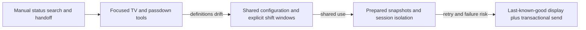
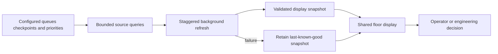
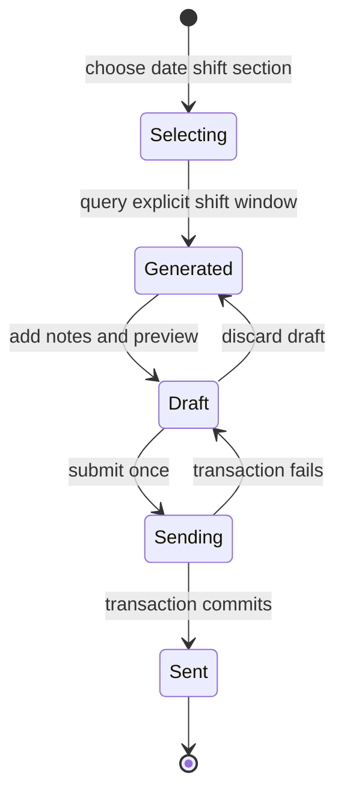

# Lean Digital Operations

**What I built:** Shared workflows that prepare production priorities, define shift-reporting windows, and let teams review a handoff before controlled submission.

**What it demonstrates:** Lean workflow design, configuration-driven applications, background refresh, multi-user state management, transactional actions, idempotency, and operational reliability.

## Problem

Manufacturing teams need two different kinds of operational awareness. During a shift, people need a low-friction view of what should move next and why. At shift change, they need a durable summary of what happened, what remains at risk, and where attention is required.

Without shared workflows, people repeatedly search reports, reconstruct priorities, and assemble handoffs. Different reporting windows or stale information can make those views disagree even when they describe the same work.

## What I built

The [Manufacturing Application Platform](MANUFACTURING_APPLICATION_PLATFORM.md) provides shared access to two workflows:

- **During the shift:** Fab TV groups production work into operational queues and shows progress toward configured checkpoints on a continuously visible browser display.
- **At shift change:** Passdown assembles events, comments, and current work-in-process for a selected date and shift into an editable handoff preview.

Prepared views make priorities and reporting boundaries visible, so routine coordination starts from a common basis.

## Evolution

As the tools gained shared use, the problems changed. Operational definitions had to be consistent across users, browser refresh could not repeatedly trigger expensive source queries, shift boundaries had to be explicit, and external actions such as passdown submission needed protection from duplicate or partial writes.

## Architecture

### Ambient production visibility

### Controlled shift handoff

The floor display identifies work needing attention; the handoff preserves a reviewed account of a defined shift.

## Selected engineering challenges

### Making production status reusable instead of repeatedly reconstructed

The same production state had to be gathered and interpreted repeatedly before a team could decide what needed attention next. The information existed, but the workflow depended on who assembled the view and when they last checked it.

I moved queue membership, checkpoints, timing intervals, and priority ordering into shared configuration. A background process refreshes prepared display state in staggered cycles, while the browser polls the completed state instead of triggering a new source query. If refresh fails, the previous valid view stays available and can be labeled stale rather than disappearing.

### Defining shift boundaries as code rather than interpretation

A handoff selected only by calendar date can include the wrong events around a day/night boundary. The risk is especially subtle because the resulting message may still look reasonable.

I formalized date-and-shift window functions, loaded the selected production population once, and applied section and presentation filters locally. The workflow keeps the loaded time window explicit while allowing users to refine the handoff without silently changing its source population.

### Protecting external actions from retries and double submissions

A browser retry, double click, or uncertain response can submit the same passdown more than once. Disabling a button in the browser is not enough because the server and database still need to handle a repeated request safely.

I assigned each draft a submission identity, protected against repeated submission, deduplicated recipients, wrote recipient batches inside one transaction, committed only after all inserts succeeded, and rolled back on error.

### Separating shared state from user-specific state

A shared manufacturing snapshot should not be rebuilt every time one user changes a filter, and one user's edits or selections should not alter another user's workflow.

I separated common refreshed state from browser/session-level choices. Shared source work is prepared once, while user-specific filters, draft content, and submission state remain isolated.

## Result

Teams can review current priorities and prepare handoffs using shared production state and explicit shift windows. Submission has controlled server-side state transitions, so retries and failures are handled beyond the browser. These workflows put the hosted platform to practical use in recurring manufacturing coordination.

### Tester tracking and shift handoff

Recent work extends this approach to physical chip testing. The applications reconstruct tester
activity and changeovers, connect work-order history and current WIP, and assemble shift-specific
handoff reports with operator notes and a preview before sending. Completed-work-order history
is prepared separately so repeated review can reuse local analytical state.

WIP history adds a second time contract: a current capture is not interchangeable with the exact
shift boundary. The workflow gives completed boundary snapshots priority, labels unavailable
history, and bounds catch-up work so historical backfill does not crowd out current visibility.

These changes make the time, population, and completeness of the operating view explicit.

## My ownership

I designed and implemented the queue/checkpoint presentation, configuration-driven prioritization, background refresh and display caching, shift-window and filtering workflow, editable preview, server-side session behavior, transactional queue submission, duplicate protection, and portal integration.

Manufacturing priority decisions, staffing and shift policy, source records, display hardware, database email-queue infrastructure, and recipient ownership remained with their respective process and system owners.

## Tradeoffs

- **Shared configuration:** improves consistency but creates an operational dependency whose changes require validation.
- **Polling prepared state:** is simple and robust for floor displays, while streaming would reduce latency at the cost of more connection and recovery complexity.
- **In-process session state:** protects large datasets and keeps user choices isolated, but a multi-process deployment would need a shared session store.
- **Email-based handoff:** fits an established workflow but is less queryable than a dedicated collaboration or event system.

## Confidentiality

This case study uses generic workflow terminology and excludes private production queues, recipient lists, operating rules, database objects, and employer data. The architecture and engineering decisions reflect the work I personally designed and implemented.
