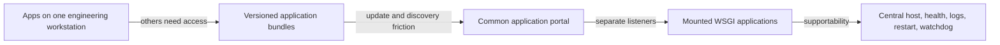
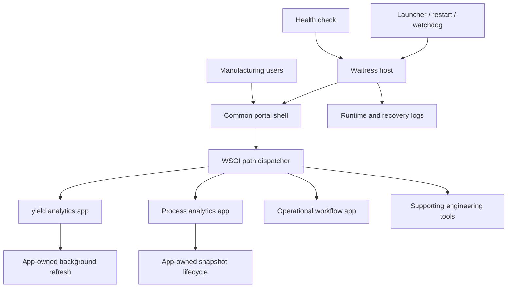
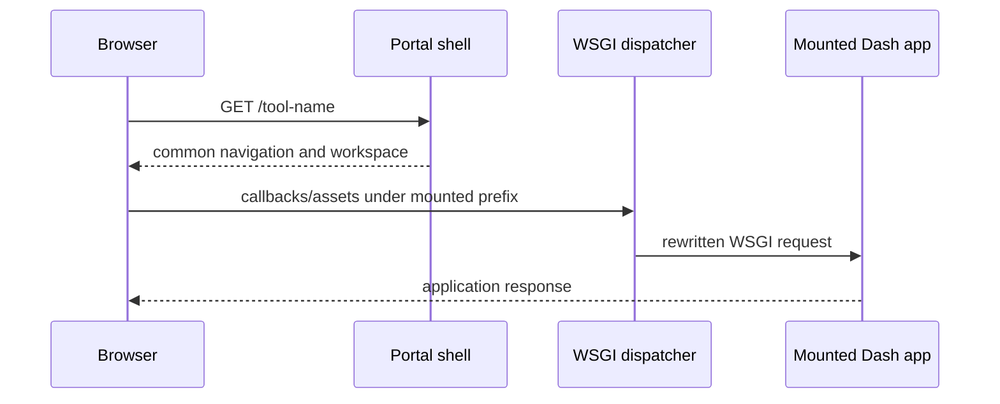

# Manufacturing Application Platform

**What I built:** A shared browser portal and hosting platform that gives engineers, technicians, and operations teams access to custom tools for yield investigation, production visibility, and daily manufacturing workflows.

**What it demonstrates:** Application integration and delivery, Windows hosting, WSGI composition, deployment design, health and recovery tooling, and cross-functional troubleshooting with IT and database teams.

## Problem

Manufacturing teams need consistent access to the tools they use to investigate quality signals, review production status, and complete shared work. A useful application on one engineer's workstation is only the beginning: other users need to find it, receive updates, and know who can restore it when something fails.

My early tools ran as individual scripts, desktop applications, or local dashboards. As use expanded, separate ports, local copies, inconsistent launch instructions, duplicated hosting logic, and manual recovery became part of the engineering problem.

## Measured use

Combined usage logs from two hosts recorded **3,081 application page opens and
reloads in the 30 days from September 16 to October 16, 2026**. The total was
recomputed from saved usage snapshots, covering analytics, operational workflows,
and application landing pages.

The tracker excludes tagged dashboard-rotation traffic and does not count chart
callbacks, button/filter interactions, assets, or health checks. Opens can include
repeat visits and manual testing; they do not establish unique users or departmental
reach. Tracking coverage changed during October, so this is a measured period of
use rather than a monthly growth claim.

The practical value is a common place to investigate yield, inspect process and
WIP status, prepare shift handoff, record maintenance, and manage requests. The
[operational workflows](LEAN_DIGITAL_OPERATIONS.md) and
[supporting applications](SUPPORTING_ENGINEERING_TOOLS.md) show these uses in detail.

## How the platform evolved

The delivery model evolved as more people needed the applications and shared use exposed new support requirements.

The main steps were:

1. Make application releases repeatable and versioned.
2. Provide a common portal so users had one place to discover tools.
3. Refactor Dash applications so importing them did not automatically start their own listener or background work.
4. Expose each application's WSGI server and mount applications under stable portal paths.
5. Use Waitress as the shared Windows WSGI host.
6. Add a health endpoint, logging, deterministic launch/restart commands, status checks, and watchdog behavior.
7. Isolate application import failures so one broken mount did not prevent every healthy application from starting.

## Relationship to the yield evolution

The [Manufacturing Yield Platform](YIELD.md) prepares manufacturing data and connects
yield results to the records behind them. The application platform gives people a shared
way to reach that analysis and related engineering tools. Each application retains its
own data sources, analytical logic, and workflow; the portal provides common navigation,
hosting, health checks, logs, and recovery.

The two systems improved together. Central hosting made prepared yield data reusable
across browser sessions, while shared process state required bounded caches and explicit
background-service lifecycles. The yield application continued to own transformation,
preload, targeted retrieval, and refresh. This separation let the investigation workflow
remain familiar as both data preparation and application delivery changed underneath it.

## Architecture

### Request routing

## Selected engineering challenges

### Moving applications beyond one workstation

The first tools were useful on a local engineering workstation, but other engineers eventually needed the same behavior and data interpretation. Copying applications to multiple machines solved access temporarily while creating version drift and update coordination.

I first made delivery repeatable through versioned bundles, then moved browser-based tools into a common portal and centralized host. The migration was incremental so a working application did not need a full rewrite simply to join the shared environment.

### Integrating applications that assumed they owned the process

Standalone Dash applications commonly assume they own their listener, route root, browser launch, and background services. Those assumptions conflict when multiple applications share one host.

I separated application construction from process startup, exposed each Dash application's WSGI server, made background-service startup explicit and idempotent, assigned mounted callback/asset prefixes, and dispatched stable portal paths to each application.

The result was a cleaner ownership model: the portal owns the listener and process lifecycle; each application owns its domain behavior and refresh lifecycle.

### Treating the enterprise environment as part of the system

Code that worked locally still depended on a provisioned Windows host, SQL Server connectivity, internal network access, allowed ports, domain/security policy, shared resources, persistent execution, and recovery after reboot.

I identified and troubleshot the application's concrete requirements and worked with IT and database owners to resolve host, access, connectivity, policy, and restart constraints. On the application side, I kept environment-specific paths and ports configurable rather than hard-coding infrastructure details.

This work required diagnosing problems across application code, Windows behavior, database access, networking, deployment, and enterprise ownership boundaries rather than treating every failure as a software bug.

### Turning a running script into a supportable service

A process can appear to be running while the application is unavailable. A shared service can also disappear after an exception, machine restart, or terminal-session loss.

I added a defined health endpoint, operational logs, deterministic launcher and restart commands, status checks, and watchdog logic that could detect a failed health check and reissue the launcher. Mounted application failures are recorded so the status of healthy applications remains visible.

### Containing failures in a shared host

Centralizing applications simplifies discovery and support, but shared process state introduces new risks. Startup work, background threads, mutable module globals, and route assumptions can collide inside one process.

I responded by making application creation and background startup explicit, bounding caches, isolating import errors, and pushing runtime configuration into defined interfaces. These constraints make application integration more predictable and reduce the chance that one tool's startup behavior silently affects another.

### Separating data preparation from interactive service

The platform has progressed to a two-host operating model for selected workloads. One host
prepares historical tester and WIP snapshots; the serving host consumes completed local copies.
Tester snapshot installation verifies checksums and counts before switching the active local
generation. A failed transfer preserves the previous usable generation.

Tester history uses local SQLite snapshot files. This is a workload-specific implementation;
the yield platform's prepared facts remain Parquet. Neither host opens the tester database
as a shared writable network file.

WIP preparation defines one active producer, bounded historical backfill, scheduled snapshot
copying, and a documented manual failover procedure that changes producer ownership.
Failover requires an operator; this design does not provide automatic host failover or
guaranteed continuous availability.

## Result

Engineers, technicians, and operations teams have a common browser entry point for
yield investigation, production visibility, and shared workflows. Updates and support
for hosted applications are managed centrally, with defined ways to check health,
diagnose failures, restart services, and recover usable data.

The platform gives new engineering tools an established path into shared use. Integration
now includes startup behavior, background refresh, route configuration, and recovery from
the outset. The yield dashboard and operational applications keep their own purpose while
sharing the delivery and support needed for daily work.

## My ownership

I designed and implemented the portal shell, application registry and mounting pattern, route-prefix integration, Waitress hosting configuration, health endpoint, launcher/restart/watchdog behavior, integration hardening, and incremental migration of applications into the shared service. I also diagnosed application-side requirements and worked directly with IT and database teams to resolve enterprise-environment constraints.

Enterprise network administration, domain policy, firewall policy, underlying Windows host administration, source databases, and user-device administration remained with their respective infrastructure owners.

## Tradeoffs

- **Single WSGI process:** lowers operational overhead and creates one entry point, but a faulty or memory-heavy application can affect sibling applications.
- **Incremental migration:** preserves working tools and reduces change risk, but mixed delivery models remain during the transition.
- **Scripted Windows operations:** are transparent and fit the environment, while a formal service manager or orchestrator would provide stronger lifecycle control.
- **Import isolation:** keeps healthy applications available when one integration fails, but partial readiness must be observable.

## Next technical evolution

A larger deployment could extend this design with structured centralized logging, per-application readiness checks, resource budgets, a shared cache for multi-process operation, automated release verification, secrets management, rollback automation, and stronger service lifecycle management.

## Confidentiality

This case study describes the architecture and engineering decisions using generic infrastructure terminology. Private network names, server identifiers, credentials, database objects, application routes, and employer-specific operating details are intentionally excluded.
