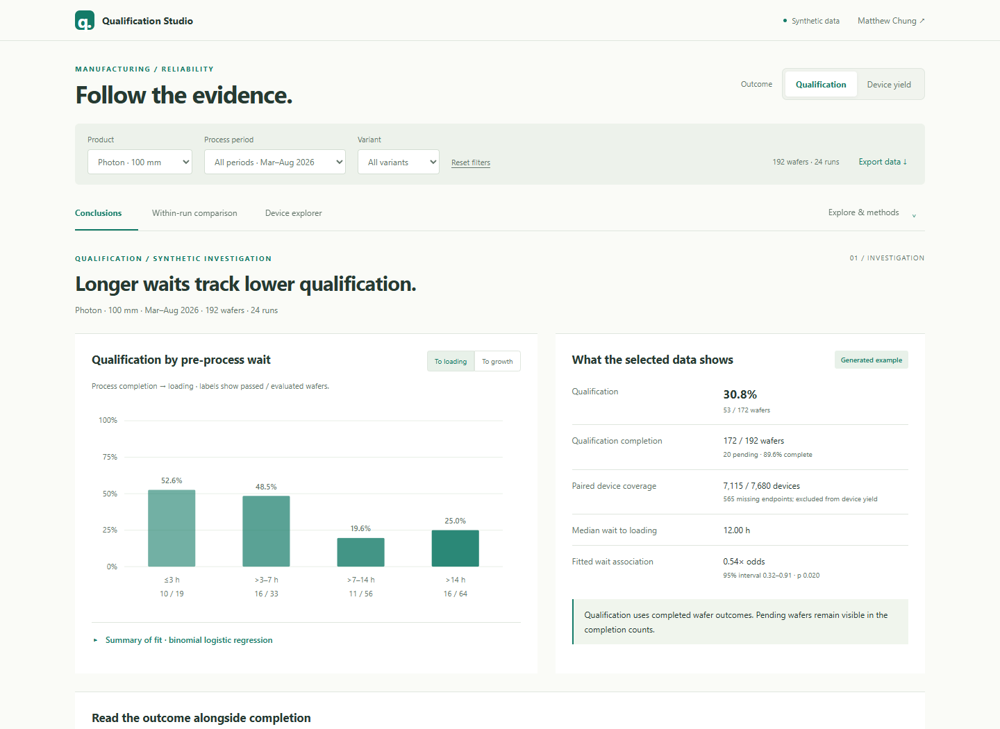

# Qualification and Reliability Investigation

**[Open the working demo](https://qualification-studio.orange-rat-4119.chatgpt.site)** · [Inspect its source](../demos/qualification-studio)

**What I built:** An engineering investigation application that connects wafer process history, waiting intervals, electrical measurements, repeated reliability tests, and qualification outcomes in one auditable workflow.

**What it demonstrates:** Quality engineering, data reconciliation, statistical modeling, reliability analysis, and the design of readable applications for technical decisions.

## Problem

Poor qualification yield creates a difficult root-cause problem: the available records describe different objects at different times. Process history follows wafers and operations. Electrical and reliability measurements follow individual devices, repeated tests, and test configurations. Final qualification decisions may arrive later, and failures can become visible before passing results.

An attractive correlation is therefore only a starting point. Engineers need to know which physical wafers were compared, whether their results are complete, whether repeated measurements were linked correctly, and whether an apparent process effect survives a more comparable population.

## Connect the evidence before fitting the model

I linked source records through physical substrate and device identities, preserving the distinction between wafer-level outcomes and device-level measurements. The investigation retains repeated-test context and pairs baseline and stressed readings within compatible measurement configurations.

The analysis distinguishes two endpoints: recorded wafer qualification and the fraction of evaluable devices meeting a reliability screen. A visible selector changes the analytical endpoint across the relevant product views. Missing or invalid pairs remain visible in coverage counts rather than silently becoming failures or passes.

Process timing is also explicit. The application compares waiting intervals to different recorded process milestones, so engineers can see whether the choice of timestamp changes the result. Product families keep their own process definitions and comparison populations.

*Screenshot of the runnable public synthetic demo. All displayed products, records, measurements, and relationships are fictional.*

## Separate a population trend from a within-run comparison

The application presents observed counts and distributions before model output. Engineers can examine time groups, calendar periods, process groups, and run positions without treating those comparisons as interchangeable.

- **Completion context:** show completed and pending wafers by period. A recent cohort with early failures and outstanding tests can give a misleading picture of its eventual qualification rate.
- **Adjusted population comparisons:** use logistic models with explicit adjustment variables and uncertainty that accounts for shared growth runs. Device yield uses passing and tested counts rather than treating a wafer percentage as a binary outcome.
- **Within-run comparisons:** compare wafers sharing a run using their relative processing positions. Conditional logistic regression supports the binary qualification comparison; grouped binomial models with run effects support the device-yield endpoint.
- **Auditable statistics:** expose the model population, fitted and observed results, coefficient estimates, confidence intervals, significance tests, and sensitivity checks. Explain odds ratios as odds rather than multipliers of the observed qualification percentage.

These are observational comparisons. Their role is to narrow the engineering investigation and test competing explanations; establishing a physical cause still requires process evidence and controlled follow-up.

## Make the findings readable without losing the detail

I developed the interface through direct engineering review. Early versions had useful comparisons but too much text and too little hierarchy. The final presentation puts a concise conclusion and its supporting counts first, followed by charts and progressively deeper statistical detail.

The interface uses a centered layout, a light palette, consistent numeric tables, compact endpoint controls, and restrained transitions. Primary analysis tabs stay visible in a slim navigation bar that hides during downward scrolling and returns on upward scrolling. A disclosure menu groups detailed tools and methods. Additional product analyses open in tabs without repeating the application header.

Statistical output is collapsed by default, while raw-data exports and definitions remain available. Responsive layouts, keyboard focus states, and reduced-motion support keep presentation choices from blocking access to the evidence.

## Result

The application turns a fragmented reliability investigation into a shared decision surface: engineers can inspect a suspected relationship, change the endpoint, compare more closely matched wafers, and trace the result back to its underlying records.

It supported process-timing hypotheses and showed where an association became weaker under a different endpoint or a within-run comparison. The result is a more focused engineering investigation and a reviewable analytical basis for follow-up. No measured yield improvement or proven physical root cause is claimed here.

## My ownership

I defined the investigation with process stakeholders, implemented identity reconciliation and data preparation, developed the statistical comparisons and exports, designed the interface, integrated the application into shared hosting, and verified the published workflows through browser checks and regression tests.

Source manufacturing systems, physical testing, process operation, and final process approvals remain with their respective owners.

## Public example

Try [Qualification Studio](https://qualification-studio.orange-rat-4119.chatgpt.site) directly. The independent, buildless browser application includes filters, outcome switching, timing charts, completion context, run and device drilldowns, searchable wafer records, and CSV exports. Its synthetic generator and small binomial model are included in the [public source](../demos/qualification-studio). It demonstrates investigation patterns without reproducing production code, data, or process rules.

For related quality workflows, see [Wafer Quality Investigation](WAFER_QUALITY_INVESTIGATION.md). For a runnable public synthetic application, see the [Manufacturing Yield Platform](YIELD.md).

## Confidentiality

This case study omits production values, screen limits, model coefficients, equipment and product identities, database objects, network details, production source code, and private screenshots. The demo's numbers and relationships are fictional and support no production or statistical claim.
