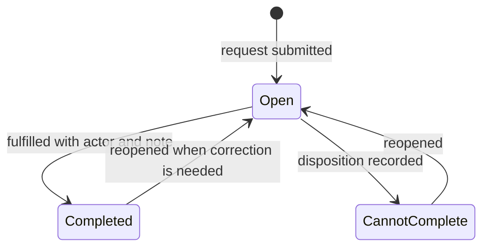

# Supporting Manufacturing Engineering Tools

Chip-yield analysis reuses the [Manufacturing Yield Platform](YIELD.md)'s prepared data. Operational workflows use the [hosted application platform](MANUFACTURING_APPLICATION_PLATFORM.md)'s shared access and support. Together, they show how investigation and daily manufacturing work build on the two flagships.

## Maintenance Operations Portal

### Problem

Recording a short repair, check, calibration, or observation should be easy near the equipment, but the complete workflow is larger than a log-entry form. Technicians also need to see scheduled work, complete one-time or recurring tasks, record why work could not be completed, attach evidence, report new issues, and perform assigned daily checks. Supervisors need controlled scheduling and an audit trail without exposing sensitive work notes in operational logs.

### How the application evolved

The first practical application reduced the effort required to record maintenance work from a phone or shared browser. Usage exposed the next problems: source selections could become stale, uploaded files needed safe storage, scheduled work needed a completion path, and recurring patrol work needed assignment and correction behavior rather than another static checklist.

### What I built

- a responsive Dash workflow optimized for phones as well as desktop browsers
- live equipment and authorized-user lookups, with selections checked again when a record is submitted
- parameterized SQL Server writes with commit/rollback behavior
- safe multi-file upload handling, sanitized paths, duplicate-name handling, and configurable limits
- scheduled and one-time task completion with explicit work notes and unable-to-complete outcomes
- recurring Process Patrol assignments by person, reusable group, or all users and by weekday
- role checks in both the interface and backend before schedule or group changes are accepted
- shared daily completion state so one completed team assignment is not presented as unfinished to every assignee
- history-preserving schedule, assignment, and group changes through retirement or deactivation instead of destructive deletion
- bounded browser payloads, progressive task lists, and cached task retrieval for a usable shared workflow
- rotating, fail-safe submission auditing that records outcome metadata while deliberately excluding work notes, attachment names, and file contents

Process Patrol is production-ready and scheduled for operational rollout. It records daily checklist outcomes and assignment history. Maintenance-record posting and attachments for patrol outcomes remain outside the current workflow.

### Role in shared operations

Maintenance is one use of the hosted platform: technicians record work and evidence in a common workflow, with controlled updates and a correction history.

### Engineering lesson

Reliable maintenance records depend on validated submissions, safe attachments, permissions, completion rules, and correction paths. Transactional writes and history-preserving state changes support that workflow beyond the initial form submission.

## Clean Room Request and Fulfillment Queue

### Problem

Requests for controlled-area garments or consumables need a clear submission path, a visible fulfillment queue, and a record of completion or inability to complete. Approximately 250 requests were handled in a recent month, based on my operational count. That figure describes usage, not a measured time-saving or productivity improvement.

### What I built

- a request form and fulfillment queue with distinct desktop and mobile presentations
- ticket-number or requester-name lookup so a requester can check status without contacting the fulfillment team
- a durable backend store behind the workflow boundary
- status tracking, periodic queue refresh, and queue filtering
- multi-select completion, cannot-complete, and reopen transitions
- fulfillment identity and comments captured with each transition
- validated photo and document attachments stored with the request record, with fulfillment photos previewed in the lookup workflow
- configuration separated from the form and queue logic

The application reached v2.0.0 as the receiving workflow matured. Requesters and fulfillers share a path from submission through disposition, with ticket lookup, mobile fulfillment, photo evidence, controlled transitions, and corrections. This is the hosted platform's daily-workflow role in practice.

### What the usage number means

The count describes use of the shared workflow. Measuring time savings would require a documented before-and-after comparison.

## Chip Yield and Manufacturing Flow Analytics

### Problem

The flagship yield workflow established trusted prepared wafer and chip facts, but chip-side engineering questions required a different view of the same manufacturing history. Rebuilding those facts in another application would duplicate transformation logic and create competing interpretations of yield.

### What I built

- a separate engineering workflow that consumes prepared Parquet facts produced by the yield data pipeline
- chip- and wafer-level yield views connected to ordered manufacturing-process context
- filters and export paths for investigating a selected product, wafer population, or process stage
- incremental cache refresh so historical analytical state can be reused without rebuilding every record
- portal integration so the workflow follows the same shared hosting and support model as the broader application environment

### Why it matters

Prepared yield facts support a different engineering question without repeating broad source retrieval or redefining core populations. The yield platform supplies that analytical foundation; portal integration supplies the shared access and support model.

## SPC and Process-Step Monitoring

The [Wafer Quality Investigation](WAFER_QUALITY_INVESTIGATION.md) visual case study shows recent
comparison and map workflows: selected wafers versus defined peers, individual failure-code rates,
statistical uncertainty, and verified spatial alignment across inspection and test evidence.

I built tools that convert selected process-step measurements into health summaries, out-of-control/out-of-specification investigation, wafer cohort views, statistical charts, review records, and exports. Configuration defines which process steps and measurements are monitored, while query/preparation logic is separated from desktop or browser presentation.

The important design boundary is between a statistical signal and an engineering disposition. Software can calculate, visualize, and prioritize signals, but the engineer still needs to interpret control limits, specification limits, sampling, repeat measurements, and process context before acting.

## Current WIP and Process-Flow Views

These applications use prepared production snapshots to show current work-in-process distribution, process-flow position, wafer-size or layer slices, and detailed operational context. A related chip-side view maps work through ordered process steps and surfaces stalled, aging, or overdue material.

The architecture allows one governed snapshot to support both summary visualization and detailed operational views without forcing every page interaction to issue a new broad source query.

## Process-Run History Explorer

The process-run history workflow supports targeted investigation across cached historical records. Correctness matters as much as speed: late or corrected records can make a cached history look plausible while silently omitting valid events.

I therefore treated refresh reconciliation and store-level validation as part of the data contract rather than as performance-only features.

## Equipment Status

I adapted equipment-status information into a responsive browser view for shared operational visibility, using the application platform's deployment, routing, and support model.

## What these projects demonstrate

These workflows apply two recurring engineering responsibilities:

- **Trustworthy evidence:** explicit identities, populations, timing, and reconciliation, with repeated source work prepared for reuse.
- **Shared operations:** controlled state transitions, user-specific choices, correction paths, and a common hosting and support model.

## My ownership

I designed and implemented the application workflows, Python transformations, visualizations, cache behavior, state transitions, and portal integrations described above.

Manufacturing definitions, source records, approvals, equipment operation, database administration, and infrastructure policy remained with their respective process and system owners.

## Confidentiality

This public summary uses generic descriptions and excludes employer source code, production identifiers, private queues, process rules, credentials, database objects, and production data.
