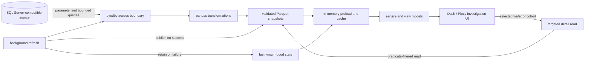

# Manufacturing Yield Platform

**What I built:** A manufacturing yield dashboard and data pipeline that help engineers locate yield losses and trace them to the affected work orders, wafers, and chips. The system connects process, wafer, and chip yield with tens of millions of inspection and test records behind the results.

**What it demonstrates:** Yield investigation, traceability, manufacturing data modeling, Python/SQL architecture, performance optimization, and reliable data delivery.

**Runnable public implementation:** [manufacturing-analytics-platform](https://github.com/4sy8zwp9hz-netizen/manufacturing-analytics-platform)

## Problem

A change in factory yield is a starting point for investigation. Engineers need to identify the affected stage and population, understand which failures account for the loss, and trace the result back to process, inspection, and test evidence. Those records describe different things at different times: a work-order event, a wafer, an inspected site, or an individual chip.

The application had to preserve that meaning while making large histories practical to explore. Repeatedly loading all detail delays the investigation; keeping only summary percentages removes the evidence needed to explain them.

This flagship provides the analytical foundation. The [Manufacturing Application Platform](MANUFACTURING_APPLICATION_PLATFORM.md) provides shared browser access and the hosting and support model that brings the workflow into daily use.

## Data scale

Yield events are central to the system: they connect work orders, manufacturing
stages, reporting dates, and pass/fail quantities to defined physical populations.
Inspection and test detail provide the evidence for investigating those results.
The data engineering challenge spans both layers.

The active prepared-data snapshot reviewed on **October 23, 2026** contained:

| Dataset role | Approximate stored rows | Why it matters |
|---|---:|---|
| Prepared process-yield records | **430,000** | Track yield quantities by wafer, work order, reporting day, and manufacturing stage |
| Final-chip yield components | **79,000** | Build final yield from defined physical populations and component quantities |
| Test-yield facts by event and parameter | **2.3 million** | Connect downstream test outcomes to the selected manufacturing population |
| Inspection-event population | **28.0 million** | Preserve detailed inspection history without loading it all into each browser session |
| Inspection failure history | **6.2 million** | Retain the evidence behind failure categories and drill-down investigations |

Prepared yield facts in the same snapshot represented **17,398 distinct wafers**.

Counts were checked against the active Parquet files' metadata. A prepared yield
record can summarize many physical units; an event can have several
test-parameter results. These datasets describe overlapping grains, so their row
counts are not additive totals of unique events or devices, and unit quantities
are not record counts. They describe one active snapshot, not accumulated backups
or the full source-system estate. The public synthetic demo demonstrates the
architecture at a smaller scale.

The challenge is both volume and meaning: reconstruct the right physical population
across repeated events and historical corrections, then make it available for
interactive use. I keep large detail datasets out of startup, preload common
facts, and retrieve only the selected cohort and required columns for deeper work.
That separates the cost of maintaining history from the cost of an engineer's next
interaction.

## How the system evolved

The first useful version queried source data with Python, transformed records with pandas, and displayed interactive Plotly figures. It established the path from a yield trend to the population and failure evidence behind it, while clarifying the relationships between work orders, wafers, operations, inspection/test results, and defect classifications.

As history and use grew, opening the dashboard could also trigger expensive retrieval and reconstruction. I separated that preparation from browser interaction: source access and transformation build reusable datasets; caches and preloads serve common views; targeted reads supply detail for a selected investigation. The visible workflow remained familiar while the backend changed substantially.

```mermaid
flowchart LR
    V0[SQL and pandas analysis] -->|source cost| V1[Scoped retrieval]
    V1 -->|repeated work| V2[Shared snapshot and cache]
    V2 -->|uneven workloads| V3[Separate preload and targeted detail]
    V3 -->|history scale| V4[Scheduled and incremental ETL]
    V4 -->|data contract changes| V5[Version-aware rebuild]
    V5 -->|service failures| V6[Atomic last-known-good publication]
```

### Backend evolution in practice

| Constraint revealed through use | Engineering change | Resulting capability |
| --- | --- | --- |
| Manufacturing records had different identities, dates, revisions, and grains | Build explicit transformation and cohort logic | Defensible, traceable yield populations |
| Small investigations still paid for broad source retrieval | Resolve the population first and scope parameterized reads | Less source scanning and transfer |
| Browsers repeatedly rebuilt common facts and indexes | Share completed server snapshots and reusable caches | Faster interactions without per-user reconstruction |
| Specialized inspection and test analysis delayed the common path | Separate reusable background preloads from lazy high-volume detail | Independent latency and memory decisions by workload |
| Historical reconstruction remained expensive | Materialize validated Parquet facts through scheduled ETL | Fast, reusable analytical state |
| Full rebuilds became wasteful and corrections could arrive late | Add incremental, correction-aware refresh where supported by the source grain | More efficient historical maintenance without ignoring changed records |
| Transformation behavior changed between releases | Version the prepared-data contract and rebuild incompatible caches | Safer cache invalidation and deployment |
| Refresh and polling could overlap or consume excess memory | Add synchronization, batching, polling guards, and bounded caches | More predictable production behavior |
| A source or rebuild failure could interrupt a working view | Publish only complete generations and retain the previous valid state | Fault-tolerant refresh and continued availability |

Each change addressed a practical constraint: keeping investigations usable as history grew,
preserving the meaning of yield calculations, and retaining a working dataset when a refresh failed.
That required ownership of extraction, transformation, prepared-data storage, refresh,
compatibility, concurrency, and memory use.

### Why the interface changed less

The table-to-drilldown workflow continued to match the engineering task. Keeping it familiar
allowed users to investigate the same way while I changed how the data was retrieved, prepared,
and refreshed. Shared preparation, bounded detail reads, and retention of the last complete
dataset improved service behavior without requiring users to learn a new interface at each release.

## Architecture

Two paths serve the investigation: prepared summaries for routine exploration and selected
detail for deeper questions. Background preparation uses the same population definitions and
publishes only a complete, validated dataset.

The common path uses prepared facts for fast exploration. High-volume chip and Sorting detail stays behind a targeted retrieval boundary and is loaded only for the selected physical wafer or scoped investigation. Refresh builds a new generation separately, validates it, and publishes it only after the complete snapshot is ready.

## Selected engineering challenges

### Defining the real manufacturing population

The source records came from manufacturing, inspection, chip, Sorting, and qualification data with different identifiers, dates, and grains. A database row could represent a wafer event, an inspected site, a chip result, or a qualification result, so source-row count could not be treated as the yield denominator.

I normalized identities with explicit precedence, assigned the date owned by each manufacturing stage, and built a stated population and numerator/denominator for every displayed row. Final chip yield was formed from the complete physical-wafer cohort required by that calculation rather than from whichever rows happened to join cleanly.

### Restricting expensive investigations before retrieval

An engineer may select a small yield population while the underlying inspection history spans a much larger dataset. Filtering only after a broad query still pays the database and transfer cost.

I first resolve the selected manufacturing population, then pass the relevant work-order/family keys into the expensive retrieval path. Detailed failure data is therefore scoped at the source or persisted-detail boundary before the application performs classification and display aggregation.

### Moving repeated work out of the click path

As the application gained history and users, opening the application or changing common filters repeatedly rebuilt data that was shared across sessions and views.

I moved common retrieval and transformation into refresh-time preparation. Completed yield facts, trends, and frequently reused Pareto data are published once and reused across browser interactions. Callbacks select from completed state instead of rebuilding the same manufacturing population.

### Separating common facts from high-volume detail

The matrix, trend, and common Pareto views are used constantly, but chip-level and parameter-level detail can be much larger and is needed only after a user selects a specific wafer or population.

I separated the workloads. Common yield facts are prepared and preloaded, specialized summaries can refresh independently, and very detailed records stay persisted until a user requests a narrow investigation.

### Keeping a failed refresh from becoming an outage

A source refresh can fail even when the application already has a valid analytical dataset. Replacing that dataset in place would turn a refresh problem into an application availability problem.

I changed refresh to build and validate a new prepared generation separately, then atomically switch the active reference only after success. If retrieval, validation, or publication fails, the previous complete snapshot remains active and the application exposes the stale/failed refresh state.

### Keeping historical results correct

A prepared dataset can refresh successfully while retaining incorrect history. Source
reconciliation therefore considers additions, corrections, and deletions, replaces refreshed
source identities, and compares changes against the last committed baseline. A failed
publication does not advance that baseline, so a retry can still detect the changes.

This extends the backend work from speed to analytical correctness over time. The recent
source-reconciliation fixes were checked with regression tests and isolated builds;
production deployment remains a separate step from that validation.

### Scaling delivery with adoption

The application began as an engineering tool on a workstation. Once other engineers relied on it, local copies and independent versions became part of the problem.

I moved delivery through versioned releases into a shared portal and ultimately centralized server hosting with common startup, refresh, health, and recovery behavior. The broader hosting evolution is described in the [Manufacturing Application Platform](MANUFACTURING_APPLICATION_PLATFORM.md) case study.

## User workflow

The public synthetic application demonstrates the same investigation pattern:

1. Start from a period-based yield matrix with an explicit population and denominator.
2. Select a period/cell to open the exact cohort behind the result.
3. Investigate Pareto, time trend, and physical-wafer scatter views.
4. Select a wafer for targeted chip or Sorting detail.
5. Export the exact selected population with lineage preserved.
6. Continue using the last valid dataset if a refresh fails, with freshness state visible.

## Result

Engineers can follow a yield change from a summary to the defined physical population, failure
breakdown, and individual-wafer evidence. The same population definitions support both the
overview and the detailed investigation, making the basis of a comparison visible and reviewable.

Prepared shared facts support common views, while narrow reads retain access to high-volume
detail. Readers do not see a partially published refresh, and a transient source failure leaves
the last valid dataset available with its freshness state visible.

### A foundation for further investigation

Chip-yield analysis and wafer-comparison tools reuse the prepared yield facts for different
engineering questions. Linked maps connect selected physical devices across
inspection and test views. Qualification investigations combine yield wafer context
with additional process, electrical, and reliability sources. This reuse makes the
dashboard's backend valuable beyond its original screens, while each investigation
still owns its cohort definition and analytical methods.

## My ownership

I designed and implemented the application architecture, Python transformations, yield population logic, cache/preload strategy, Dash/Plotly investigation workflow, targeted detail retrieval, refresh and last-known-good behavior, testing approach, public synthetic analogue, and documentation.

The manufacturing source systems, database administration, enterprise infrastructure, and physical process remain external dependencies owned by their respective teams.

## Tradeoffs

- **Prepared Parquet facts:** provide reproducible columnar snapshots and fast reads, but do not replace transactional source systems.
- **In-process cache:** is simple and effective for a single service instance; horizontal scaling would require shared cache coordination.
- **Background refresh:** protects user latency but adds lifecycle, locking, observability, and stale-data decisions.
- **Targeted persisted detail:** controls memory and bulk retrieval but adds a separate refresh and lineage contract for drill-down data.

## Explore the implementation

- [Repository overview](https://github.com/4sy8zwp9hz-netizen/manufacturing-analytics-platform#readme)
- [Architecture](https://github.com/4sy8zwp9hz-netizen/manufacturing-analytics-platform/blob/main/ARCHITECTURE.md)
- [Data flow](https://github.com/4sy8zwp9hz-netizen/manufacturing-analytics-platform/blob/main/docs/DATA_FLOW.md)
- [Yield Calculation Model](https://github.com/4sy8zwp9hz-netizen/manufacturing-analytics-platform/blob/main/docs/YIELD_CALCULATION_MODEL.md)
- [Engineering evolution](https://github.com/4sy8zwp9hz-netizen/manufacturing-analytics-platform/blob/main/docs/ENGINEERING_EVOLUTION.md)
- [Performance evolution](https://github.com/4sy8zwp9hz-netizen/manufacturing-analytics-platform/blob/main/docs/PERFORMANCE_EVOLUTION.md)

## Confidentiality

The public implementation uses reproducible synthetic semiconductor data and generic source boundaries. Employer source code, database objects, credentials, network details, production data, and confidential operating rules are not included.
